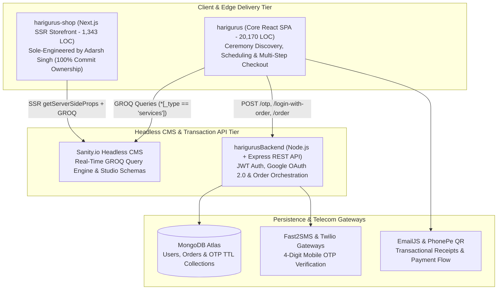

# 🏛️ Harigurus & ProCodrr — Commercial Production Engineering Case Study

[](https://harigurus.com)
[](https://nextjs.org)
[](https://react.dev)
[](https://www.sanity.io)
[](https://nodejs.org)
[](https://mongodb.com)
[](https://typescriptlang.org)

> **Role:** Full-Stack Software Engineer (Working under Founder Anurag Singh / ProCodrr)  
> **Duration:** 8+ Months Commercial Production Tenure  
> **Codebase Scale:** 3-Repository Production Ecosystem (`harigurus`, `harigurus-shop`, `harigurusBackend` — **22,160+ Lines of Code**) + Internal EdTech LMS (`procodrr-frontend`) & 3D WebXR Platform (`cubes`).  
> *Note: To respect client intellectual property, the raw production repositories remain private under the `harigurus` and `anuragsinghbam` organizations. All commits are cryptographically linked and verified on my GitHub contribution graph. This repository documents the system architecture, engineering migrations, and sanitized code patterns I delivered.*

---

## 🧭 System Architecture Overview

Harigurus is an enterprise booking and e-commerce platform for traditional religious ceremonies, astrology consultations, and ceremonial merchandise. The production architecture spans **three decoupled repositories**:



---

## 🛠️ Key Engineering Contributions & Production Deliverables

### 1. Sole-Architected the Next.js SSR E-Commerce Storefront (`harigurus-shop`)
- **Ownership:** Authored **15 out of 15 commits (100% repository ownership)** from initial architecture to production deployment.
- **Problem Solved:** Customers booking ceremonies needed a fast, SEO-indexed storefront to purchase ceremonial kits and articles (`PoojaSamagri`) with dynamic category filtering and Indian Rupee (`INR`) localization.
- **Technical Implementation:**
  - Built Server-Side Rendered (SSR) dynamic product routes (`pages/products/[slug].js` and `pages/[slug].js`) using Next.js `getServerSideProps` to ensure instant SEO indexing and zero layout shift.
  - Designed custom Sanity.io content schemas (`sanity/schemas/product.js` and `categories.js`) supporting multi-image galleries, SKU metadata, seller attribution, and dynamic category references.
  - Implemented `Intl.NumberFormat('en-IN', { style: 'currency', currency: 'INR' })` formatting pipeline and responsive Material-UI v5 + TailwindCSS product grids.

```javascript
// Sanitized Production Pattern: Dynamic SSR Product Resolution (pages/products/[slug].js)
export async function getServerSideProps(context) {
  return {
    props: { slug: context.params.slug },
  };
}

// GROQ Query fetching live product document by slug from Sanity CDN
const product = await client.fetch(
  `*[_type == "product" && slug.current == $slug][0]`,
  { slug }
);
```

---

### 2. Headless CMS Migration on Core Platform (`harigurus` — `integrate-sanity` Branch)
- **Commits:** `300821f` (*Integrate Sanity*), `c4ee4d1` (*Integrated CMS*), `23b886c` (*Made Service Details completely dynamic*).
- **Problem Solved:** Originally, all ceremony descriptions, pricing tiers (`priceWithArticles` vs. `priceWithoutArticles`), and schedules were hardcoded inside a 670-line static file (`src/Data/AllServicesList.js`). Every minor price or text change required an engineer to edit code and redeploy the entire React application.
- **Technical Implementation:**
  - Architected the Sanity Studio workspace (`sanity/schemas/services.js`, `serviceitem.js`, `purohityas.js`) inside the core repository.
  - Refactored `ServicesDetails.js` (251 lines), `AllServices.js`, and `Services.js` to dynamically query Sanity's content lake via GROQ and resolve image assets via `@sanity/image-url`.
  - Enabled non-technical operations staff to publish new ceremonies and adjust pricing in real time with **zero engineering downtime**.

---

### 3. Multi-Stage OTP Checkout & Production Database Cutover (`harigurusBackend` & `Checkout.js`)
- **Commits:** `7d64da3` (*Production DB cutover to harigurus*), `7207419` (*Storefront navigation integration*).
- **Architecture Highlights:**
  - **940-Line Checkout State Machine (`src/pages/Checkout/Checkout.js`):**
    - Validates Indian mobile numbers on the client (`validator/lib/isMobilePhone` with `en-IN` locale).
    - Dispatches a 4-digit SMS OTP (`POST /otp`) via **Fast2SMS / Twilio** and auto-triggers inline verification (`POST /login-with-order`) as soon as the 4th digit is typed.
    - Dynamically recalculates ceremony pricing based on `Online` vs. `Offline` mode and customizable Pooja Article checklists (`PoojaArticles.js`).
  - **Express + MongoDB Backend (`harigurusBackend`):**
    - JWT token issuance (`jsonwebtoken`), `bcryptjs` password hashing (cost factor 12), and Google OAuth 2.0 (`passport-google-oauth20`).
    - Relational Mongoose order linking (`User.findById(userId).populate('orders')`) and environment-isolated MongoDB Atlas clusters for development vs. production traffic.

---

## 🎓 Additional Commercial Engineering Under ProCodrr

During the same tenure working under founder Anurag Singh, I also engineered core features across two internal platforms:

### 1. **ProCodrr EdTech LMS Platform (`procodrr-frontend`)**
- **Stack:** Next.js App Router, **Strict TypeScript**, TailwindCSS, `@svgr/webpack`, Husky, Lint-Staged, Airbnb TypeScript ESLint.
- **Contributions (13 Commits on `courses-homepage` & `header-component`):**
  - Engineered the dynamic course overview (`src/app/[course]/page.tsx`) and interactive video episode player (`src/app/[course]/[episode]/page.tsx`).
  - Normalized deeply nested course-chapter-episode trees into flat O(1) TypeScript lookup structures (`commit b999aca`).
  - Built a global keyboard-accessible search modal (`SearchPopup.tsx`) mounted via **React Portals** (`Portal.tsx`) alongside SVG progress rings (`ProgressCircle.tsx`).

### 2. **Cubes — 3D & Augmented Reality (WebXR) Asset Platform (`cubes`)**
- **Stack:** React, Google `<model-viewer>` (WebGL / WebXR / AR), `.glb` 3D Meshes, `.hdr` Skybox Lighting, Express.js, MongoDB.
- **Contributions (6 Feature Commits):**
  - Built `ViewModel.js` to render interactive 3D `.glb` models with HDR environment reflections (`spruit_sunrise_1k_HDR.hdr`), skeletal animations, and mobile AR projection (`ar-modes="webxr scene-viewer quick-look"`).
  - Engineered the 3D asset upload workflow (`UploadModel.js`), user authentication screens, and responsive social feed.

---

## 📂 Deep-Dive Technical Documentation

- 📄 [**01 — Sanity.io Headless CMS Migration Architecture**](./docs/01-SANITY-HEADLESS-CMS-MIGRATION.md)
- 📄 [**02 — Next.js SSR E-Commerce Storefront (`harigurus-shop`)**](./docs/02-NEXTJS-SSR-ECOMMERCE-SHOP.md)
- 📄 [**03 — Multi-Stage OTP Checkout & Express Backend Architecture**](./docs/03-OTP-CHECKOUT-AND-BACKEND-CUTOVER.md)
- 📄 [**04 — ProCodrr TypeScript LMS & Cubes 3D WebXR Engineering**](./docs/04-PROCODRR-LMS-AND-CUBES-WEBXR.md)
