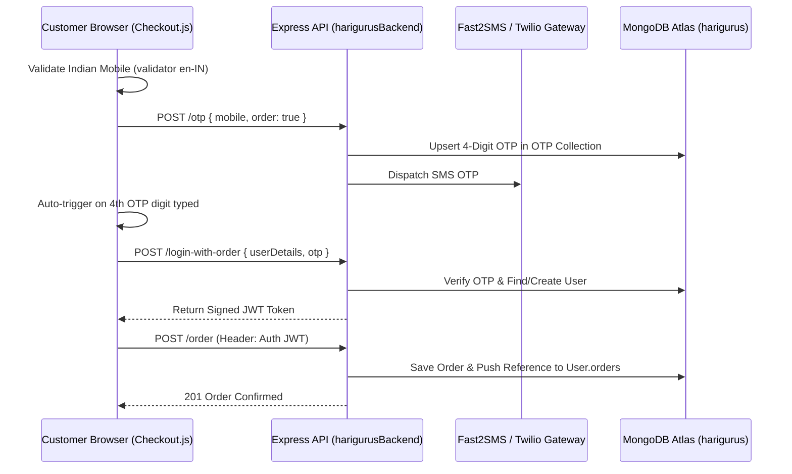

# 03 — Multi-Stage OTP Checkout & Express Backend Architecture

## Overview
The Harigurus booking flow (`Checkout.js` — 940 lines) and its backing REST API (`harigurusBackend`) handle real-world ceremony scheduling, user verification, and order persistence.

---

## Checkout & Authentication Pipeline

---

## Key Backend Security & Persistence Features
- **Password & OTP Hybrid Auth (`controllers/user-controllers.js`):**
  - Supports both passwordless 4-digit SMS OTP login and `bcryptjs` (12 salt rounds) password authentication, plus **Google OAuth 2.0** (`passport-google-oauth20`).
- **Production Database Isolation (`commit 7d64da3`):**
  - Separated development and live customer databases on MongoDB Atlas (`harigurus`) with strict Mongoose schema validation (`mongoose-unique-validator`).
